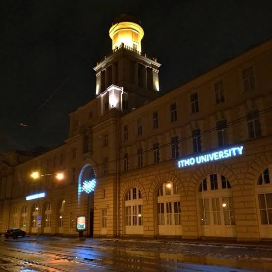
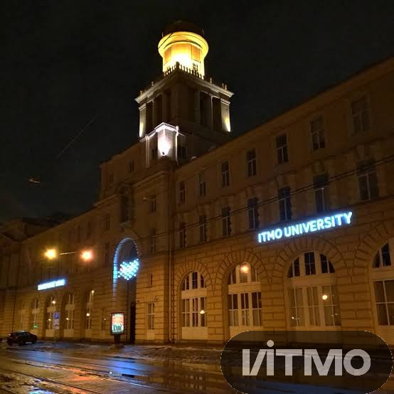

# BMP Watermark
  [](https://github.com/NikiGleb/bmp-watermark/actions/workflows/ci.yml)

Проект на C++, разработанный для наложения водяного знака на изображение в формате BMP.

Учебный проект по дисциплине «Инструментальные средства разработки ПО», ИТМО.

## Технологии

- CMake — сборка;
- Git и GitHub — контроль версий;
- GitHub Actions — автоматическая сборка и запуск тестов.


## Сборка

Требуется компилятор с поддержкой C++17 и CMake 3.10 или новее.

```bash
cmake -S . -B build
cmake --build build
```

Собираются две программы: `build/watermark` и `build/watermark_tests`.

## Запуск

```bash
./build/watermark <image.bmp> <watermark.bmp> <output.bmp>
```

- `image.bmp` — исходное изображение;
- `watermark.bmp` — водяной знак, не больше исходного изображения;
- `output.bmp` — куда сохранить результат.

Пример:

```bash
./build/watermark photo.bmp logo.bmp result.bmp
```

## Алгоритм наложения

Водяной знак накладывается в правый нижний угол изображения. Каждый пиксель под знаком смешивается с пикселем знака отдельно по каждому каналу:

```
new = original * (1 - kAlpha) + watermark * kAlpha
```

- `kAlpha` — непрозрачность знака, задаётся в `src/watermark.cpp`: `0.0` — знака не видно, `1.0` — знак полностью закрывает изображение;
- результат округляется до ближайшего целого и всегда лежит между двумя исходными цветами, поэтому переполнения нет;
- белые пиксели водяного знака считаются фоном и не накладываются — на изображении остаётся только сам рисунок знака;
- пиксели вне знака не меняются.

Белый фон вокруг водяного знака не накладывается: в каждой строке знака пропускаются белые пиксели слева до начала рисунка и справа после его конца. Белые пиксели внутри рисунка смешиваются как обычно.

## Формат BMP

Поддерживается только 24-битный BMP без сжатия (заголовок BITMAPINFOHEADER) с положительной высотой.

- Файл начинается с заголовка файла (14 байт) и информационного заголовка (40 байт).
- Пиксели начинаются со смещения `bfOffBits` из заголовка файла (54 байта).
- Каждый пиксель занимает 3 байта в порядке B, G, R.

## Тесты

Тесты запускаются из корня проекта (пути к тестовым картинкам относительные):

```bash
./build/watermark_tests
```

Каждая проверка печатает `[OK]` или `[FAIL]`. Если хоть одна не прошла, программа завершается с кодом 1. В GitHub Actions тесты запускаются при каждом push и pull request в `main`.

### 1. Красная картинка 10×10 — запись и чтение BMP

`test_10_10_red` создаёт в памяти красное изображение 10×10, сохраняет его в файл и сравнивает по пикселям с эталоном, нарисованным в Paint (`tests/bmps/test1/10_10_red.bmp`).

| Эталон |
|---|
|  |

### 2. Чёрный квадрат 3×3 на белой картинке 10×10 — позиция и смешивание

`test_add_black_square_on_white_picture` накладывает чёрный знак 3×3 на белую картинку 10×10 и сравнивает результат с эталоном из Paint (`tests/bmps/test2/`). 

| Исходное изображение | Водяной знак | Результат |
|---|---|---|
|  |  |  |

### 3. Логотип ИТМО на фотографии — реальные изображения

`test_itmo` накладывает логотип ИТМО (244×89) на фотографию (554×554) и сравнивает результат по пикселям с эталоном `tests/bmps/test4/expected.bmp`, полученным программой. 

| Исходное изображение | Водяной знак | Результат |
|---|---|---|
|  |  |  |

## Структура проекта

```
.github/workflows/ci.yml  — сборка и тесты в GitHub Actions
include/bmp_image.hpp     — структуры заголовков BMP, Pixel и класс BmpImage
include/watermark.hpp     — объявления функций наложения водяного знака
src/bmp_image.cpp         — чтение и запись BMP
src/watermark.cpp         — смешивание пикселей и наложение водяного знака
src/main.cpp              — программа: аргументы командной строки
tests/tests.cpp           — автотесты
tests/bmps/               — изображения для тестов
docs/images/              — PNG-копии тестовых изображений для README
CMakeLists.txt            — описание сборки
```

## Автор

Никишин Глеб Олегович, группа M3104.
